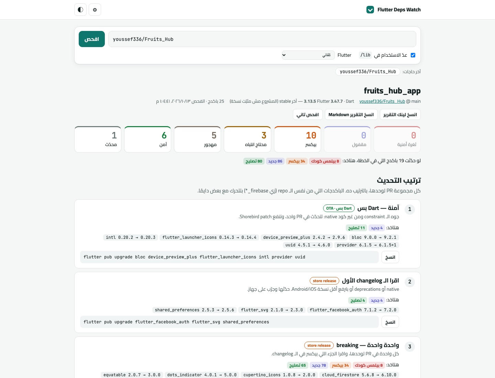

<p align="center"></p>

<h1 align="center">Flutter Deps Watch</h1>

<p align="center">
  Paste any Flutter repo from GitHub and see, package by package, what is outdated, what will break, what is vulnerable, and in which order to upgrade.
</p>

<p align="center">
  <a href="https://youssef336.github.io/flutter-deps-watch/"></a>
  
  
  
  
  
</p>

<p align="center">
  
  <br/><sub>Live site: scan of a real Flutter repo</sub>
</p>

> **English summary.** Flutter Deps Watch is a zero-backend, zero-build web tool (Arabic UI). Give it a
> GitHub repo link and it reads `pubspec.yaml`, `pubspec.lock` and the pinned Flutter version, asks
> pub.dev about every dependency (latest version, SDK requirement, discontinued status, pub points,
> security advisories), unpacks each package's archive in the browser to show only the CHANGELOG
> entries between your version and the latest (split into breaking / new / fixed, with hits in your
code), counts how many files in `lib/` import it, and sorts
> everything into *vulnerable / locked / breaking / needs attention / abandoned / safe*. The result is
> an ordered upgrade plan with copy-ready `flutter pub` commands, a shareable `?repo=owner/name` link
> and a one-click Markdown export for PRs. An optional **"explain this upgrade"** button streams an
> Egyptian-Arabic walkthrough from your own Claude or Gemini key, grounded in the changelog and the lines of
> *your* code that use the package. Plain ES modules, no dependencies, unit-tested in headless Chrome.

**🔗 الموقع:** https://youssef336.github.io/flutter-deps-watch/

<div dir="rtl">

حط لينك أي repo Flutter على GitHub، والصفحة تقولك حالة كل باكدج في `pubspec.yaml`:
إيه القديم، وإيه اللي هيكسر، وإيه اللي عليه ثغرة، وبأي ترتيب تحدّث. كله بيشتغل في
المتصفح: مفيش server، ولا تسجيل دخول، ولا build step.

## ✨ بيعمل إيه

- 📄 **بيقرا** `pubspec.yaml` (ومعاه التعليقات اللي فوق كل باكدج) و `pubspec.lock` و `.fvmrc` من الـ repo.
  لو الـ repo فيه أكتر من مشروع (monorepo) بيسألك تختار أنهي واحد.
- 📦 **بيسأل pub.dev** عن كل باكدج: آخر نسخة وتاريخها، والـ SDK اللي محتاجه، ولو كان
  discontinued، والـ pub points، والثغرات المنشورة (advisories).
- 📝 **بيقولك هتاخد إيه من كل تحديث**: بيجيب الـ CHANGELOG من أرشيف الباكدج نفسه (بيفك الـ `.tar.gz`
  جوه المتصفح)، ياخد بس اللي بين نسختك وآخر نسخة، ويقسمه لـ **بيكسر / اتضاف / اتصلح** (والباقي docs و
  dependencies في «تاني»). بيفهم أشكال الـ changelog المشهورة: `**FIX**`/`**FEAT**` بتاعة melos، و
  `fix:`/`feat!:`، و `### Added`/`### Fixed`، و `**Bugs**`، و `Fixed:`، و «Fixes …/Adds …».
  العدد بيظهر على كل باكدج، وعلى كل مجموعة في الخطة («هتاخد: 12 تصليح · 5 جديد»)، وعلى المشروع كله.
- 🎯 **«في كودك»**: لو حاجة بتكسر أو اتصلحت بتذكر API بين `backticks`، الصفحة بتدوّر عليه في
  الفايلات اللي بتعمل import للباكدج ده عندك، ولو لقته بتعلّم عليه.
- 🤖 **«اشرحلي التحديث ده» بالـ AI**: زرار على كل باكدج بيكتبلك بالمصري:
  **الخلاصة** (التحديث عن إيه، و«حدّث دلوقتي / حدّث بحذر / استنى»)، و**اتصلح / اتضاف / بيكسر**
  (والـ breaking بيقولك بيلمس أنهي فايل عندك)، و**هتعمل إيه** (الأمر، وتعديلات الكود، وخطوات
  native لو فيه، وتجرّب إيه). بيبعت للموديل الـ changelog **والسطور من كودك** اللي بتستخدم الباكدج،
  فالشرح على مشروعك مش كلام عام، وبيتحفظ على جهازك فمش بتدفع تاني لنفس التحديث.
- 🔎 **بيعدّ الاستخدام**: أنهي فايلات في `lib/` بتعمل import لكل باكدج.
- 🏷 **بيصنّف** كل باكدج في واحدة من دول:

  | التصنيف | يعني |
  |---|---|
  | 🛡 ثغرة أمنية | نسختك عليها advisory منشور |
  | 🔒 مقفول | override / git / path / تعليق زي "do not bump" |
  | 💥 بيكسر | major، أو الـ changelog بيقول breaking، أو محتاج Flutter/Dart أحدث |
  | ⚠️ محتاج انتباه | plugin فيه native، أو deprecations، أو بيرفع minSdk/iOS، أو متثبّت على نسخة بالظبط |
  | 🪦 مهجور | discontinued، أو مفيش نسخة جديدة من سنة ونص |
  | ✅ آمن | تحديث جوه الـ constraint ومفيش علامات خطر |

- 🗺 **بيطلّعلك خطة**: مجموعات بالترتيب (أمان، آمن Dart، آمن native، انتباه، breaking)،
  ولكل مجموعة أمر `flutter pub` جاهز تنسخه. الباكدجات اللي من نفس الـ repo
  (`firebase_*`، riverpod، `*_plus` …) بتتحرك مع بعض دايمًا.
- 🔗 **التقرير ليه لينك** (`?repo=owner/name`) تبعته لأي حد، وزرار ينسخه Markdown عشان تحطه في PR.
- 🌗 وضع فاتح وغامق.

## 🔐 الـ Private repos

من ⚙︎ حط GitHub token (fine-grained، وصلاحيته **Contents: Read-only** بس). الـ token
بيروح لـ `api.github.com` وبس، ومش بيتحفظ غير لو علّمت «افتكره». من غير token الـ repos
العامة شغالة عادي، بس GitHub بيسمح بـ 60 طلب API في الساعة (وكل فحص بياخد 2).

## 🤖 مفتاح الـ AI

من ⚙︎ اختار المزوّد وحط مفتاحك:

- **Gemini**: فيه خطة مجانية. هات مفتاح من https://aistudio.google.com/apikey ودوس «هات الموديلات».
- **Claude**: من https://console.anthropic.com/settings/keys. الافتراضي Claude Opus 5.5 (الأدق)،
  وفيه Sonnet 5.5 و Haiku 4.5 أرخص. لو الموديل رفض طلب، بيتعاد تلقائيًا على الموديل البديل
  اللي Anthropic بتنصح بيه (`fallbacks: "default"`).

المفتاح بيروح لمزوّد الـ AI وبس (من المتصفح على طول)، ومش بيتحفظ غير لو علّمت «افتكر».
خلي بالك إن كل شرح بيبعت سطور من كودك للمزوّد ده.

## 🎯 الـ Flutter اللي بيقارن بيه

بياخده من `.fvmrc` أو `.fvm/fvm_config.json` أو `.tool-versions`. لو المشروع مش مثبّت
نسخة بيقارن بآخر stable، وتقدر تختار نسخة تانية من القايمة.

## ⚖️ الحدود

- مفيش resolution زي `pub outdated`: لو باكدج تانية ماسكة باكدج عند نسخة معينة، هتفضل
  ظاهرة إنها قابلة للتحديث.
- «native» معناها إن الباكدج Flutter plugin، مش إن الإصدار ده بالذات غيّر كود native.

</div>

## 🛠 Tech stack

- Vanilla JavaScript (ES modules), HTML and CSS: no framework, no npm dependencies, no build step.
- APIs (all CORS-enabled, called straight from the browser): GitHub REST + `raw.githubusercontent.com`,
  pub.dev API (packages, scores, security advisories) and package archives, Flutter release index.
- Optional AI: the official Anthropic TypeScript SDK (loaded as an ES module from jsDelivr) or the Gemini
  REST API, streamed straight from the browser with the viewer's own key.
- Native browser `DecompressionStream` + a tiny tar reader to pull `CHANGELOG.md` out of package archives.
- Hosted on GitHub Pages; tests run in headless Chrome via GitHub Actions.

## 🏗 Project structure

| File | Role |
|---|---|
| `js/semver.js` | pub-flavoured versions and constraints |
| `js/pubspec.js` | pubspec / lock / changelog / advisory parsers (keeps comments) |
| `js/classify.js` | verdict per package + upgrade plan |
| `js/notes.js` | changelog → breaking / feature / fix / other, and "used in your code" hits |
| `js/ai.js` | "explain this upgrade": prompt + code excerpts, Claude (official SDK) and Gemini, streaming |
| `js/github.js`, `js/pub.js` | GitHub, pub.dev and Flutter-release lookups |
| `js/tar.js` | gunzip + tar reader for package archives |
| `js/scan.js` | one scan, end to end |
| `js/main.js`, `js/labels.js`, `js/md.js` | page, Arabic strings, safe Markdown for changelogs |
| `tests/` | in-browser unit tests (the AI tests mock `fetch` and run the real SDK) |
| `tool/test.sh` | runs the tests in headless Chrome |

## 🚀 Getting started

```bash
git clone https://github.com/youssef336/flutter-deps-watch.git
cd flutter-deps-watch
python3 -m http.server 8000      # then open http://localhost:8000
bash tool/test.sh                # unit tests in headless Chrome (set CHROME=... if not auto-detected)
```

## 📄 License

[MIT](LICENSE)

## 👤 Author

**Youssef Belal Zakaria** · [GitHub @youssef336](https://github.com/youssef336)

⭐ If you like this project, give it a star!
